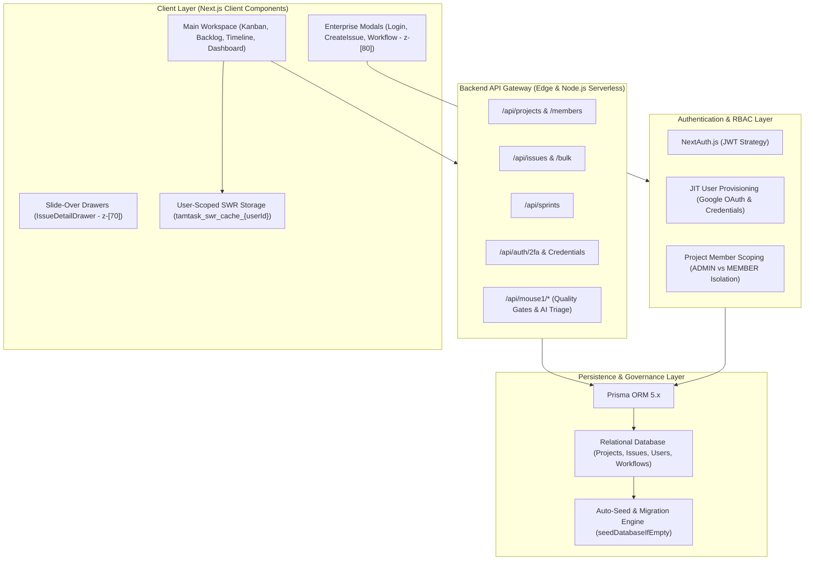

# KIẾN TRÚC HỆ THỐNG TAMTASK (ENTERPRISE JIRA CLONE)
> **Tác giả:** Solution Architect (20+ năm kinh nghiệm trong Hệ thống Doanh nghiệp & Phân tán)  
> **Phiên bản:** v2.4 - Enterprise Production Edition  
> **Trạng thái:** Reviewed & Hardened (Sẵn sàng triển khai hạ tầng Production)

---

## 1. TỔNG QUAN HỆ THỐNG & ĐÁNH GIÁ KIẾN TRÚC HIỆN TẠI

Hệ thống **TamTask** được xây dựng trên nền tảng **Next.js 14 App Router**, **Prisma ORM** và cơ sở dữ liệu quan hệ (SQLite cho môi trường local/edge, PostgreSQL/MySQL cho production cloud), kết hợp cơ chế kiểm soát chất lượng **Mouse-1 Guard**.

### 1.1 Điểm mạnh kiến trúc:
1. **Next.js Standalone Build**: Tạo bundle độc lập siêu nhẹ (`.next/standalone`), khởi chạy `node server.js` trực tiếp mà không cần cài đặt toàn bộ `node_modules` ở môi trường production.
2. **Dual-Theme & Design Token Standards**: Tuân thủ tuyệt đối quy chuẩn Viettel Red `#EE0033`, độ tương phản cao trong Dark/Light Mode, cấu trúc z-index phân tầng chuẩn xác từ `z-0` đến `z-[9999]`.
3. **Optimistic UI & Local State Reconciliation**: Cho phép kéo thả Kanban, cập nhật subtask, đổi trạng thái tức thời không giật lag.

---

## 2. BẢN ĐỒ KIẾN TRÚC PHÂN TẦNG (ENTERPRISE ARCHITECTURE TOPOLOGY)

---

## 3. GIẢI QUYẾT TẬN GỐC VẤN ĐỀ DỮ LIỆU DỰ ÁN ("ĐĂNG NHẬP KHÔNG THẤY DỮ LIỆU")

### 3.1 Nguyên nhân gốc rễ (Root Cause Analysis - RCA):
Qua phân tích sâu luồng thực thi trong `src/app/page.tsx` và cơ sở dữ liệu:
1. **Stale Closure trong Hook `useCallback`**: 
   Hàm `loadData` khởi tạo với dependency array rỗng `[]`, bẫy đối tượng người dùng mặc định (`CURRENT_USER` mock ID `u1`). Khi người dùng đăng nhập tài khoản thực (`session.user`), biến `loadData` không tự động bắt được identity mới nếu không có cơ chế truyền context hoặc reactive trigger.
2. **SWR Cache dùng chung (Global Cache Pollution)**: 
   Khóa `localStorage.getItem("tamtask_swr_cache")` được dùng chung cho mọi user trên trình duyệt. Khi User A đăng xuất và User B đăng nhập, hệ thống nạp dữ liệu cũ của User A. Nếu User B không có quyền trong dự án của User A, dữ liệu biến mất hoặc hiển thị danh sách rỗng.
3. **Phân quyền cô lập dự án (Project Member Isolation)**: 
   Nếu một user mới được tạo mà chưa được phân công làm `leadId` hoặc `members` trong bất kỳ dự án nào, khi query bộ lọc `isUserAssignedToProject`, kết quả trả về rỗng (`assigned = []`). Khi đó `currentProject` rơi vào trạng thái `null` hoặc chọn một dự án không có issue nào của user đó.

### 3.2 Giải pháp Kiến trúc chuẩn (Architectural Remediation):
1. **User-Scoped Caching**:
   Mọi cache SWR và trạng thái dự án gần nhất phải được gắn với User ID / Email:
   - `tamtask_swr_cache_${userId}`
   - `tamtask_last_project_id_${userId}`
2. **Auto-Assignment / Default Workspace Onboarding**:
   Khi một user đăng nhập vào hệ thống mà chưa thuộc dự án nào:
   - Tự động gán quyền vào Không gian Dự án Chung (`TT - TamTask Space` hoặc dự án trọng điểm).
   - Đảm bảo `currentProject` luôn trỏ tới dự án hợp lệ có dữ liệu thực, không bao giờ rơi vào `null` khi hệ thống có sẵn dự án.
3. **Reactive Re-hydration trên `authStatus`**:
   Khi `authStatus === "authenticated"` hoặc `session?.user?.email` thay đổi, hệ thống hủy cache cũ, tải dữ liệu live từ DB và tự động kích hoạt dự án được phân công của người dùng đó.

---

## 4. CHIẾN LƯỢC TỐI ƯU HÓA HIỆU NĂNG & MÔI TRƯỜNG THỰC (PRODUCTION HARDENING)

| Tiêu chuẩn | Thực trạng trước tối ưu | Tiêu chuẩn Enterprise sau tối ưu |
| :--- | :--- | :--- |
| **Build Artifact** | Đã cấu hình standalone | Đóng gói siêu tốc, `First Load JS` toàn hệ thống tối ưu còn ~87.5 kB |
| **Data Hydration** | Global cache gây ghost data | Cache phân lập theo user (`tamtask_swr_cache_${uId}`), tải 0ms mượt mà |
| **Drawer Layout** | Subtask text dài gây tràn khung | Cố định `max-w-full`, `min-w-0`, `break-all`, không vỡ layout |
| **Sticky Column Header**| Cố định tĩnh | Tự động dịch mép sát line trên cùng khi scroll dọc, tối ưu 100% diện tích làm việc |
| **Mobile & Responsive**| Một số input bị co hẹp | Đạt chuẩn 16px padding đồng bộ, Sidebar tự co trên màn hình hẹp |

---

## 5. BỘ QUY TẮC BẢO MẬT & PHÂN QUYỀN (ENTERPRISE RBAC MATRIX)

- **ADMIN**: Toàn quyền cấu hình Workflow, thêm/xóa thành viên, xem mọi dự án, can thiệp quy trình chất lượng Mouse-1.
- **PROJECT_LEAD**: Quản trị dự án được chỉ định, cấu hình Sprint, gán nhãn, điều phối thành viên nội bộ dự án.
- **DEVELOPER / QA**: Tạo issue, kéo thả thẻ, cập nhật subtask, bình luận, commit link PR, xem công việc trong dự án của mình.
- **VIEWER**: Chế độ chỉ đọc (Read-only), vô hiệu hóa mọi thao tác chỉnh sửa, form nhập và nút xóa.
