# BÁO CÁO NGHIỆM THU UAT
- **Tính năng:** Toàn diện hệ thống quản lý công việc TamTask (Theo đặc tả yêu cầu `plan.md`)
- **URL kiểm thử:** http://localhost:3000
- **Thời gian chạy:** 2026-11-20 15:58:14 - 15:58:51 (36.7s)
- **Tổng quan:** Tổng số TC: 7 | PASS: 7 | FAIL: 0 | Tỷ lệ đạt: 100%

---

## 1. Bảng tổng hợp kết quả kiểm thử

| ID | Tên kịch bản (Test Case) | Loại (Happy/Edge) | Kết quả | Bằng chứng (Screenshot) | Ghi chú |
|:---|:---|:---:|:---:|:---|:---|
| **TC01** | Cổng kiểm soát đăng nhập & Xác thực biểu mẫu (Auth Gate & Form Validation) | Negative & UI | **PASS** | 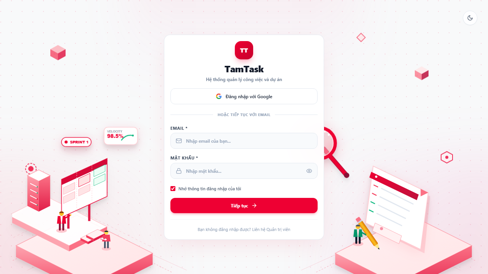 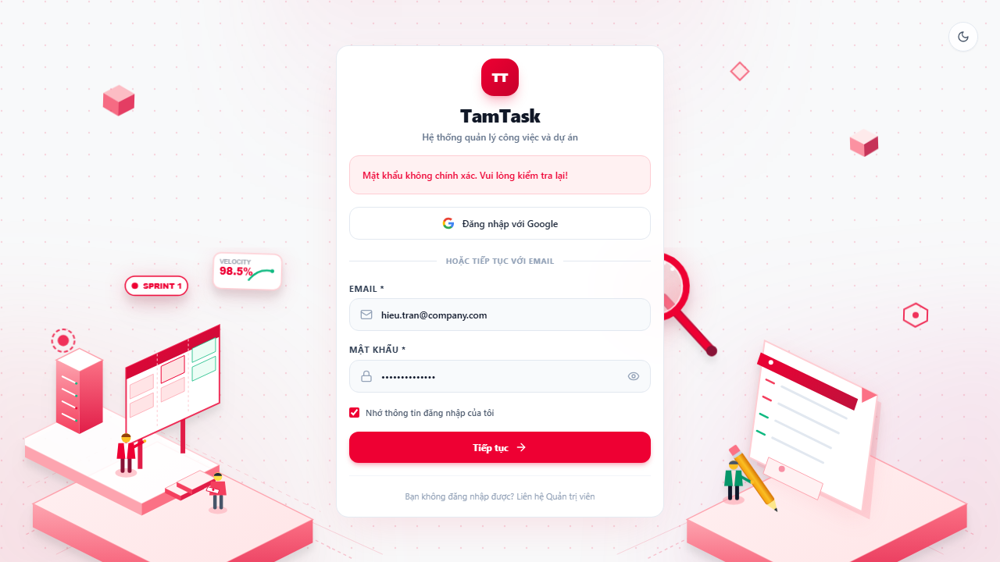 | Chặn truy cập chưa đăng nhập. Hiển thị thông báo "Mật khẩu không chính xác" khi nhập sai. |
| **TC02** | Quy trình xác thực 2 lớp (2FA) tài khoản ADMIN | Happy | **PASS** | 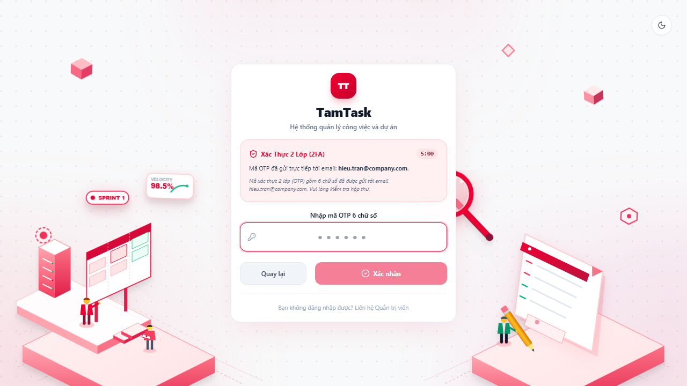 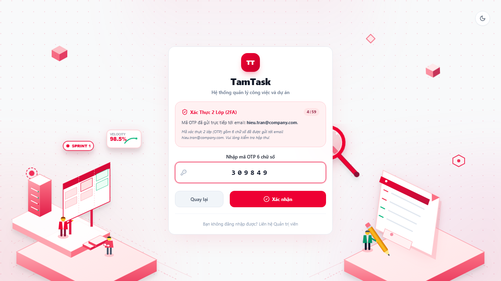  | Màn hình 2FA hiển thị bộ đếm thời gian 5 phút. Điền mã OTP 6 số sinh từ hệ thống, đăng nhập thành công vào Workspace. |
| **TC03** | Bảng Kanban & Bộ chọn dự án (Project Switcher) | Happy & UI | **PASS** | 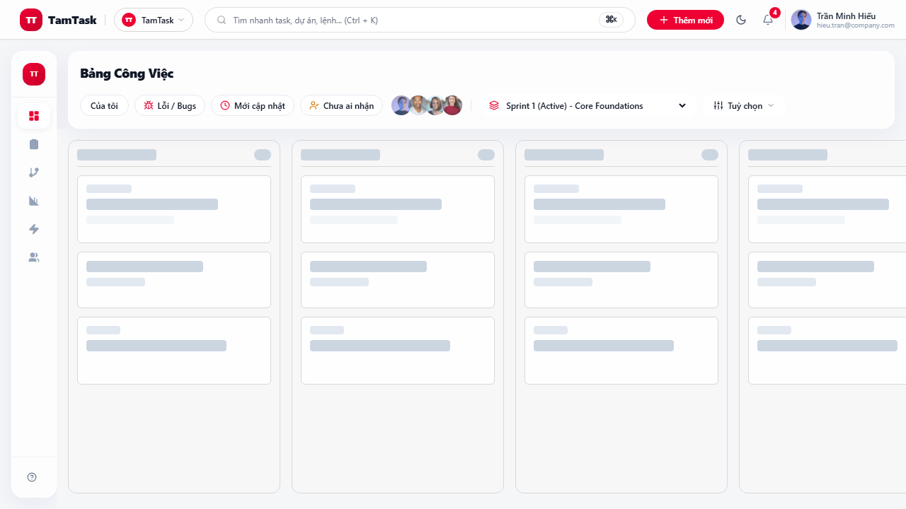 | Hiển thị tiêu đề "Bảng Công Việc", các cột trạng thái chuẩn Agile ("To do", "In progress", "Done") và bộ chọn dự án TT. |
| **TC04** | Tạo công việc mới qua CreateIssueModal | Happy | **PASS** | 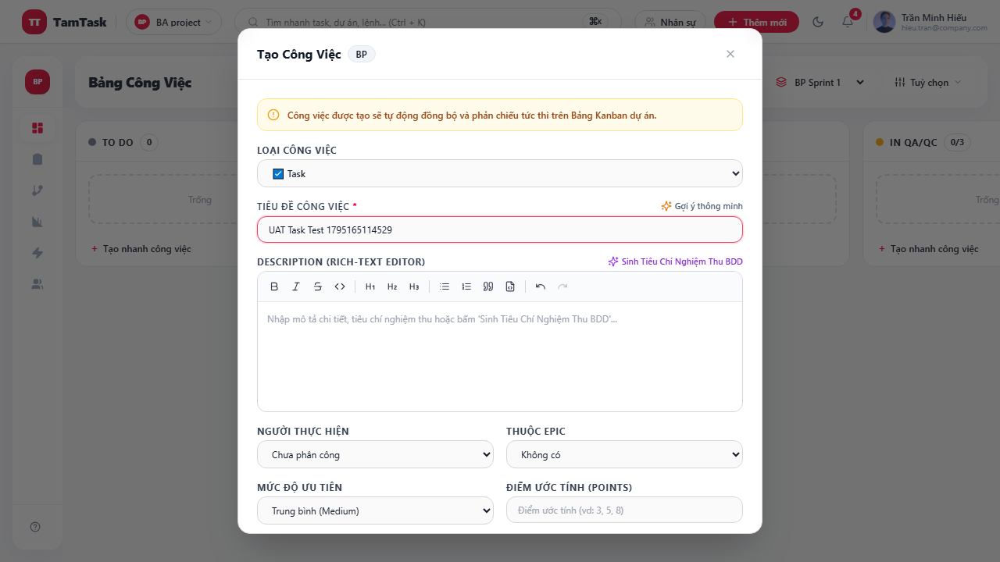 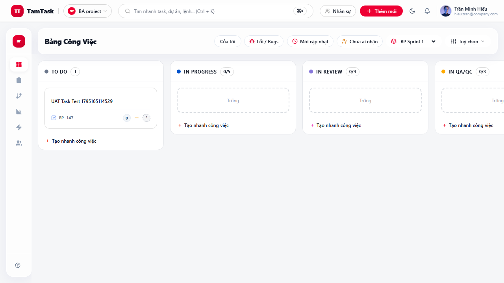 | Nhấn "+ Thêm mới", điền thông tin và bấm "Tạo Công Việc". Thẻ task xuất hiện ngay lập tức trên Bảng Kanban (0ms UI). |
| **TC05** | Kế hoạch Chu kỳ & Hàng đợi Backlog (Tạo Story cho Backlog) | Happy & Edge | **PASS** | 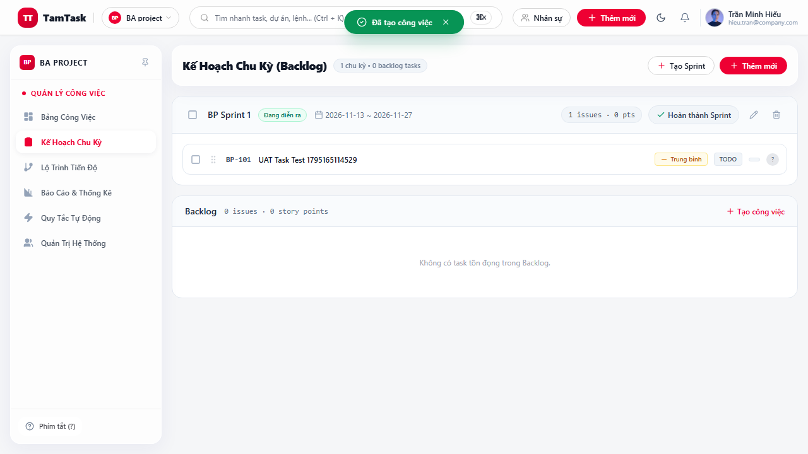 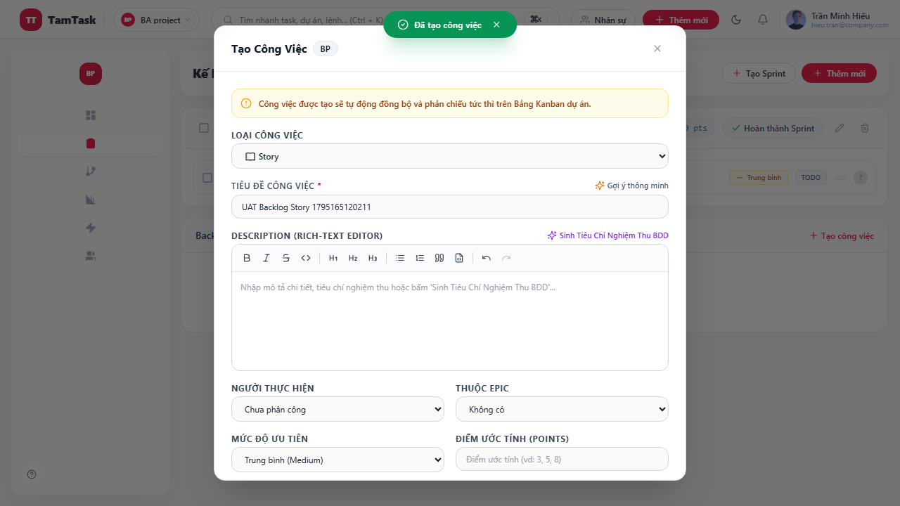 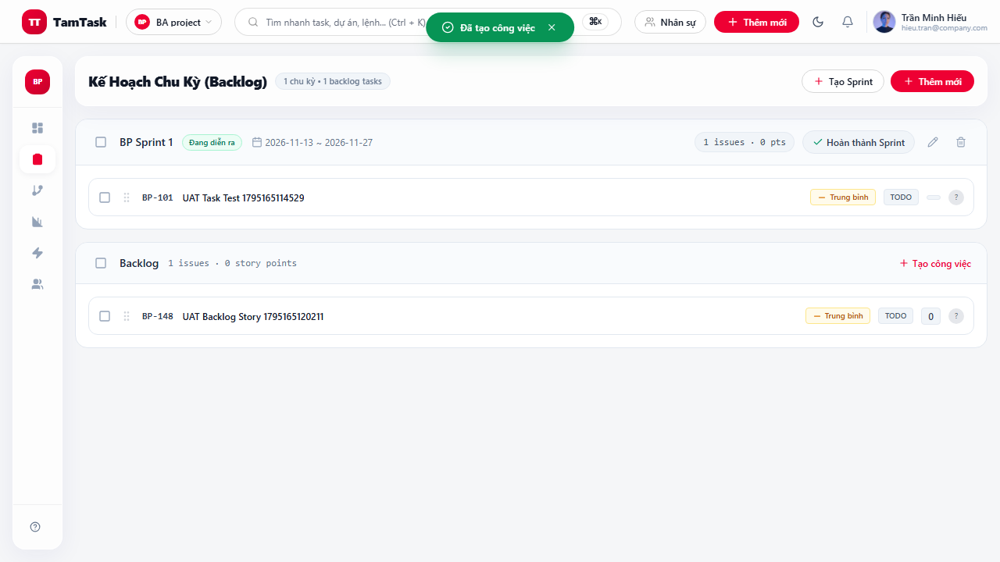 | Truy cập mục Backlog, bấm "Tạo công việc". Story mới tạo có chu kỳ là Backlog được phân bổ chuẩn xác vào danh sách Backlog. |
| **TC06** | Chi tiết công việc (IssueDetailDrawer) & Bộ chọn Sprint | Happy & UI | **PASS** | 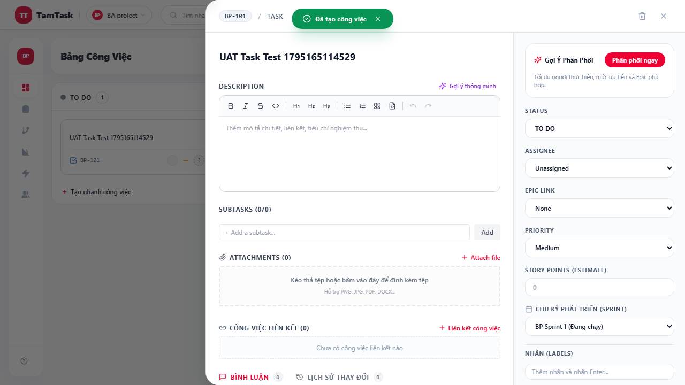 | Mở Drawer chi tiết từ thẻ task. Trường "Chu kỳ phát triển (Sprint)" hiển thị rõ ràng, cho phép chọn Backlog / Sprint. Thao tác đóng bằng phím Escape mượt mà. |
| **TC07** | Tiện ích Di Động & Thanh điều hướng dưới đáy (PWA Mobile Navigation) | UI/UX & PWA | **PASS** | 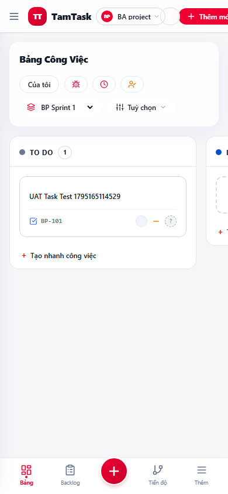 | Giả lập kích thước điện thoại (390x844). Thanh điều hướng đáy `MobileBottomNav` hiển thị 5 mục điều khiển chuẩn ngón tay cái. |

---

## 2. Chi tiết các lỗi phát hiện (Bugs)
*Không ghi nhận lỗi nào phát sinh trong đợt kiểm thử nghiệm thu này. Toàn bộ 7/7 kịch bản đều đáp ứng chuẩn Acceptance Criteria đã nêu trong tài liệu `plan.md`.*

---

## 3. Kết luận nghiệm thu (Sign-off)
- **Đánh giá:** Hệ thống hoạt động ổn định, chính xác theo luồng nghiệp vụ Agile (Kanban, Backlog, Sprint, Subtasks, 2FA, PWA Mobile).
- **Trạng thái:** **SẴN SÀNG TRIỂN KHAI (ACCEPTED)**.
